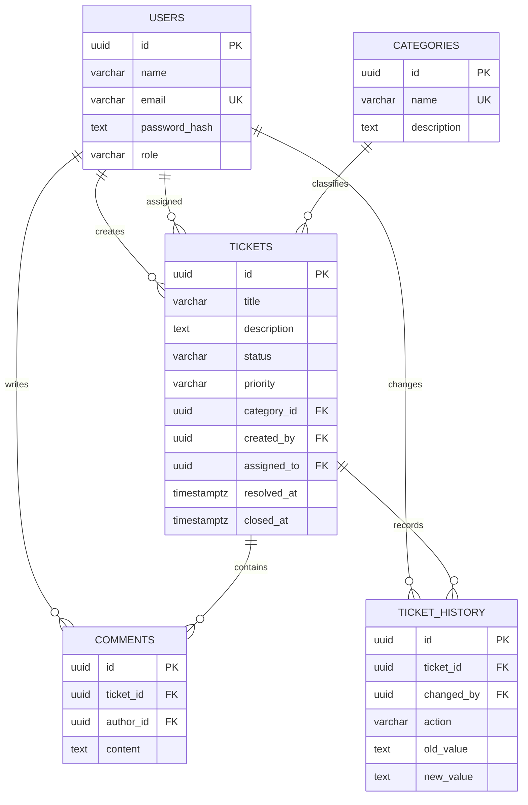

# Database

PostgreSQL stores five core tables. UUID primary keys are generated with `pgcrypto`. Status, priority, and role values are protected by check constraints.

Indexes cover ticket status, priority, category, creator, assignee, creation time, and the ticket foreign keys used by comments and history.

Deleting a category referenced by a ticket returns a conflict. Tickets are never physically deleted through the API; cancellation is a status transition. Comments and history use cascading foreign keys only to preserve database consistency if a ticket is removed administratively outside the API.
