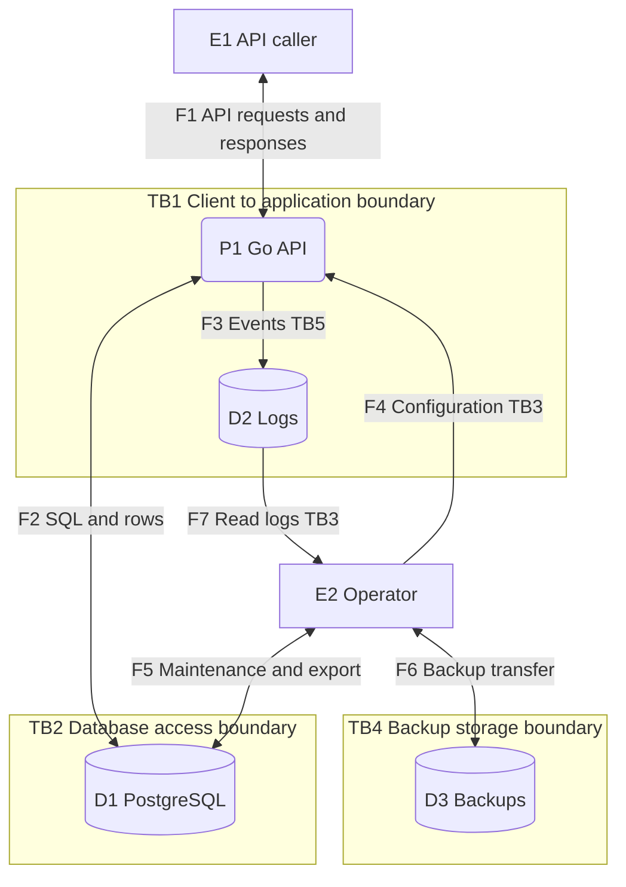

# Threat model

| Field | Value |
| --- | --- |
| Version | 1.0.0 |
| Updated | 2026-10-17 |
| Owner | HNU Tickets repository maintainer |
| Method | Simplified STRIDE by DFD element |

## Scope

This model covers the Go API, PostgreSQL, operational logs, required backup storage and operator access to them in one organization. It analyzes browser/integration callers at the API boundary. Client internals, physical access, host operating-system internals and dependency-provider internals are outside the model.

Backup storage is an operational requirement, not a currently implemented scheduled component. Repository/CI and dependency controls are specified in [Security policy](security_policy.md) and SEC-R09; this DFD focuses on support-data processing and privileged operational flows.

## Assets and objectives

Protect account credentials and tokens, ticket/comment text, identities and roles, workflow state, audit evidence and recoverable data. Required properties are authenticated identity, authorized access, valid/atomic mutations, traceability, confidentiality and availability.

## System overview

The API is a modular monolith with Auth, Users, Categories, Tickets, Comments, History and Analytics. Roles are USER, SPECIALIST and ADMIN. The API performs object checks and stores business data in PostgreSQL. Operators manage deployment settings and maintenance outside the application role model.

### DFD elements

| ID | DFD type | Name | Meaning |
| --- | --- | --- | --- |
| E1 | External Interactor | API caller | Anonymous caller or authenticated USER/SPECIALIST/ADMIN; client implementation outside scope. |
| E2 | External Interactor | Operator | Privileged deployment, database, log and backup access through managed tools. |
| P1 | Process | Go Web API | Authentication, authorization, workflow, validation and relational analytics. |
| D1 | Data Store | PostgreSQL | Accounts, categories, tickets, comments and ticket history. |
| D2 | Data Store | Operational logs | API stdout/log collection and retained internal errors. |
| D3 | Data Store | Backup storage | Required operational store; a scheduled backup service is not implemented in the repository. |
| F1 | Data Flow | E1 ↔ P1 | API credentials, bearer tokens, ticket commands and responses. |
| F2 | Data Flow | P1 ↔ D1 | Parameterized SQL and returned rows under a runtime database identity. |
| F3 | Data Flow | P1 → D2 | Request metadata and internal error/diagnostic events. |
| F4 | Data Flow | E2 → P1 | Deployment settings, credentials and JWT signing secret. |
| F5 | Data Flow | E2 ↔ D1 | Migration, administration, logical export and restoration through operator tools. |
| F6 | Data Flow | E2 ↔ D3 | Transfer, retrieval and expiration of backup copies. |
| F7 | Data Flow | D2 → E2 | Reading logs for diagnostics and incident handling. |

### Data flow diagram

E2 uses managed administration/backup tools outside the API process boundary. F5 reads/restores PostgreSQL and F6 transfers the resulting copy; the diagram does not imply the API performs backups. Flows are logical channels; HTTPS and verified database TLS are required controls rather than assumptions that the current development configuration already provides.

### Trust boundaries

| ID | Boundary | Enforcement and assumption |
| --- | --- | --- |
| TB1 | Caller ↔ API, F1 | Untrusted input becomes an authenticated and authorized operation only after server checks |
| TB2 | API/operator ↔ PostgreSQL, F2/F5 | Database identities, privileges, network restrictions and verified remote TLS |
| TB3 | Operator ↔ API configuration/log access, F4/F7 | Separate infrastructure authentication and permissions; application ADMIN does not cross this boundary automatically |
| TB4 | Operator ↔ backup storage, F6 | Restricted encrypted storage, transfer protection, retention and verified recovery |
| TB5 | API ↔ log destination, F3 | Controlled log writer/collector permissions and protected diagnostic content |

## Attacker model

| ID | Attacker | Initial access and capabilities |
| --- | --- | --- |
| A1 | External unauthenticated caller | Public API endpoints; can submit arbitrary requests and repeatedly attempt login; no initial account or secret. |
| A2 | Authenticated USER | Valid USER token and own tickets; can guess identifiers and alter request bodies/filters. |
| A3 | Authenticated SPECIALIST | Valid specialist token and assigned tickets; may attempt foreign access or retain an old privileged token. |
| A4 | Malicious/compromised ADMIN account | Application administration endpoints; does not inherently hold operator, GitHub or direct database privileges. |
| A5 | Compromised client session | Stolen valid bearer token; can replay permitted requests until effective invalidation or expiry. |
| A6 | Privileged operator or compromised operator identity | Can access approved configuration, database, logs or backups; capabilities depend on assigned infrastructure privileges. |
| A7 | Network-positioned attacker | Can observe, alter or interrupt traffic only where the channel/network position permits; cannot break correctly verified TLS or forge a signed JWT without its key. |

No attacker is assumed able to defeat correctly implemented cryptography without a key or bypass infrastructure controls by definition. A compromised privileged identity can cross only the boundaries for which it actually has permissions.

## STRIDE analysis

S = Spoofing; T = Tampering; R = Repudiation; I = Information Disclosure; D = Denial of Service; E = Elevation of Privilege.

| DFD type | Applicable categories |
| --- | --- |
| External Interactor | S, R |
| Process | S, T, R, I, D, E |
| Data Store | T, I, D |
| Data Flow | T, I, D |

Trust boundaries identify where assumptions change; they are not extra process rows with six automatic categories. A threat may affect multiple elements/categories. Repeated references below represent a common scenario crossing several relevant elements.

### Coverage by element

| Element | S | T | R | I | D | E |
| --- | --- | --- | --- | --- | --- | --- |
| E1 | TM-01 | — | TM-02 | — | — | — |
| E2 | TM-03 | — | TM-04 | — | — | — |
| P1 | TM-01 | TM-05 | TM-08 | TM-07 | TM-09 | TM-06 |
| D1 | — | TM-10 | — | TM-11 | TM-12 | — |
| D2 | — | TM-13 | — | TM-14 | TM-15 | — |
| D3 | — | TM-16 | — | TM-17 | TM-18 | — |
| F1 | — | TM-19 | — | TM-19 | TM-09 | — |
| F2 | — | TM-20 | — | TM-20 | TM-12 | — |
| F3 | — | TM-21 | — | TM-21 | TM-15 | — |
| F4 | — | TM-22 | — | TM-22 | TM-22 | — |
| F5 | — | TM-23 | — | TM-23 | TM-12 | — |
| F6 | — | TM-24 | — | TM-24 | TM-18 | — |
| F7 | — | TM-25 | — | TM-25 | TM-25 | — |

### Threat register

| ID | Element | STRIDE | Scenario | Impact / observed condition | Requirements | Priority |
| --- | --- | --- | --- | --- | --- | --- |
| TM-01 | E1, P1 | S | Stolen credentials or a bearer token let A1/A5 impersonate a participant. | Account access and permitted ticket data. | SEC-R01, SEC-R03, SEC-R04 | High |
| TM-02 | E1 | R | A participant denies a ticket change when actor/session evidence is insufficient. | Disputed responsibility for changes. | SEC-R06 | Medium |
| TM-03 | E2 | S | A stolen operator identity is used to act as the authorized maintainer/operator. | Configuration and stored data. | SEC-R04, SEC-R09 | High |
| TM-04 | E2 | R | An operator denies direct maintenance that was not recorded. | Missing accountability outside ticket history. | SEC-R06, SEC-R08 | Medium |
| TM-05 | P1 | T | An authorized actor exploits a missing assignee/current-role condition to create an invalid workflow update. | Invalid assignment or unauthorized author edit; G-02 remains, G-03 is resolved. | SEC-R02, SEC-R06 | High |
| TM-06 | P1 | E | A demoted account reuses an issued token carrying its previous privileged role. | Privileged access unless current-role checks are enforced; addressed by G-01 resolution. | SEC-R02, SEC-R03 | High |
| TM-07 | P1 | I | A caller manipulates a ticket UUID or filter to obtain another participant's ticket/comments/history. | Disclosure of support content. | SEC-R02, SEC-R05, SEC-R10 | High |
| TM-08 | P1 | R | Login, role or maintenance actions cannot be reliably reconstructed from the available audit data. | Insufficient security-event traceability; ticket history is only partial coverage. | SEC-R06 | Medium |
| TM-09 | P1, F1 | D | Repeated authentication or expensive requests consume API capacity and block legitimate requests. | Service unavailability; per-process throttling mitigates G-05. | SEC-R07 | High |
| TM-10 | D1 | T | An overprivileged runtime/operator identity changes ticket history or records directly. | Data/audit integrity loss; G-04. | SEC-R06 | High |
| TM-11 | D1 | I | Direct database access or a copied database volume exposes accounts, password hashes and support messages. | Confidentiality loss. | SEC-R04, SEC-R10 | High |
| TM-12 | D1, F2, F5 | D | Connection exhaustion, blocking work or interrupted database access prevents reads/writes. | Database and dependent API outage. | SEC-R07, SEC-R08 | Medium |
| TM-13 | D2 | T | A principal with log-write access alters or removes diagnostic evidence. | Investigation integrity loss. | SEC-R06 | Medium |
| TM-14 | D2 | I | Internal errors or careless logging reveal credentials or personal text to a log reader. | Secondary data disclosure. | SEC-R05, SEC-R10 | High |
| TM-15 | D2, F3 | D | Unbounded logging or unavailable log storage exhausts space or loses events. | Reduced availability and lost diagnostic evidence. | SEC-R07, SEC-R10 | Medium |
| TM-16 | D3 | T | A backup copy is modified or an unauthorized old copy is selected for restoration. | Corrupt/inconsistent recovery or reintroduced removed data. | SEC-R08, SEC-R10 | High |
| TM-17 | D3 | I | An unprotected backup is downloaded by an unauthorized principal. | Bulk disclosure outside normal API visibility. | SEC-R04, SEC-R08, SEC-R10 | High |
| TM-18 | D3, F6 | D | Backup copies are deleted, unreachable or unusable when recovery is needed. | Failure to restore service/data. | SEC-R08 | High |
| TM-19 | F1 | T, I | A network-positioned attacker reads or alters API traffic when HTTPS is absent or certificate checking is bypassed. | Credential theft or changed commands/responses. | SEC-R04 | High |
| TM-20 | F2 | T, I | An exposed database channel without verified TLS permits interception or endpoint substitution. | SQL result/credential disclosure or altered data flow. | SEC-R04 | High |
| TM-21 | F3 | T, I | An unauthorized log collector/pipe reader intercepts or rewrites emitted events. | Diagnostic leakage or altered audit evidence. | SEC-R06, SEC-R10 | Medium |
| TM-22 | F4 | T, I, D | Configuration delivery exposes or replaces a signing key/database credential, or supplies unusable settings. | Forged sessions, database access or failed startup. | SEC-R01, SEC-R04, SEC-R09 | High |
| TM-23 | F5 | T, I | An unprotected privileged database/export channel exposes records or allows altered maintenance input. | Bulk disclosure or destructive maintenance. | SEC-R04, SEC-R06, SEC-R08 | High |
| TM-24 | F6 | T, I | Backup transfer is intercepted or a destination is substituted. | Backup disclosure or untrusted recovery input. | SEC-R04, SEC-R08 | High |
| TM-25 | F7 | T, I, D | The log-reading path leaks records, substitutes events or becomes unavailable during investigation. | Wrong conclusions, disclosure or delayed response. | SEC-R06, SEC-R10 | Medium |

High priority denotes exposure of credentials/privileged functions, bulk data loss or a major service/recovery failure. Medium denotes narrower operational impact or a scenario requiring additional privileges. Priorities are qualitative design judgments based on prerequisites and consequences, not measured exploitability scores.

## Existing controls and remaining exposure

| Area | Existing mechanism | Remaining work |
| --- | --- | --- |
| Identity | bcrypt and signed expiring HS256 JWTs | Current-role lookup, persistent per-token logout and bounded peer limits; distributed limits require ingress configuration |
| Object access | Scoped lists and ticket access checks reused by comments/history | Author edits explicitly check current USER role; negative role/access regression checks cover G-03 |
| Workflow integrity | Domain transition matrix, transactions and ticket row locks | Assignee precondition on generic status changes; G-02 |
| Data access | Parameterized SQL, foreign keys and allowed-value constraints | Separate runtime/migration privileges and history protection; G-04 |
| Transport/secrets | Required secret configuration and CORS allowlist | HTTPS, verified remote DB TLS, secret rotation and restricted ports; G-07 |
| Recovery/privacy | Defined data categories and acceptance scenarios | Executed backup recovery, retention and removal procedures; G-08/G-10 |

G-06 is a pending workload recommendation feature, not itself proof of a security vulnerability. Existing mechanisms reduce relevant exposure but do not establish that every acceptance scenario has passed.

## Derived requirements and verification

Every TM entry identifies its SEC-R controls in [Security requirements](security.md). Verification scenarios SEC-01–SEC-11 provide the acceptance cases. In particular:

- TM-05/TM-06 require current-role and assignment-invariant checks: SEC-03–SEC-05.
- TM-07 requires cross-user and cross-specialist object access tests: SEC-02.
- TM-02/TM-08/TM-10 require actor-linked evidence, rollback and restricted history mutation: SEC-06/SEC-08.
- TM-16–TM-18 require isolated restore, expired-copy handling and removal replay: SEC-09/SEC-11.
- TM-19/TM-20/TM-22 require network/configuration checks: SEC-10.

## Review triggers

Update element/flow IDs and repeat applicable STRIDE categories when authentication, roles, integrations, persistence, deployment or data categories change. Review priorities after new evidence, incidents or control changes. Preserve threat IDs so requirements and verification records remain traceable.

Related: [Architecture](architecture.md), [Security policy](security_policy.md), [Privacy policy](privacy_policy.md), [Security requirements](security.md).
